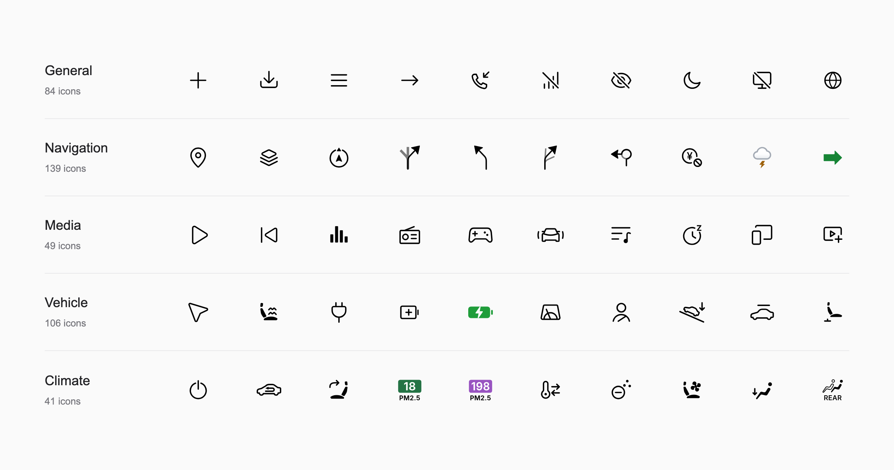
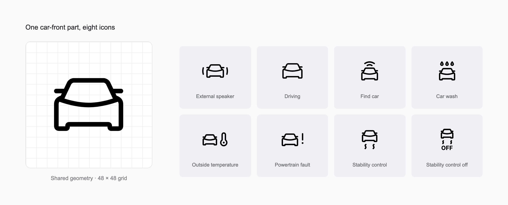

# Dashline

**419 cockpit icons and 77 reusable parts for automotive interfaces.** Designed by Paxton Yao with Claude and Codex, using shared geometry and written design rules.

[Open Dashline](https://paxton0209.github.io/Dashline/) · [Design notes](DESIGN.md) · [Icon guidelines](https://github.com/Paxton0209/paxton-design-system/blob/main/icons/icon-guideline.en.md) · [中文说明](#中文说明) · [License](LICENSE.md)



## What's inside

| General | Navigation | Media | Vehicle | Climate | Total |
|:---:|:---:|:---:|:---:|:---:|:---:|
| 84 | 139 | 49 | 106 | 41 | **419** |

Icons use a 48 × 48 grid, a nominal 40 px safe area and a 2 px primary stroke, with optical adjustments for individual shapes. Open any icon in the browser to inspect its parts and copy a standalone SVG. The browser supports search, light and dark themes, and keyboard navigation.

## An icon library with its own parts library

Recurring shapes are stored as reusable parts: the car front, the charging bolt, the turn arrowhead and the off slash. The current library contains 77 parts. One car-front part appears in 8 icons; one maneuver arrowhead appears in 59.

Parts keep the set consistent. Composed icons reuse the same base geometry, so updates to a shared part flow through its references. In the browser, open an icon to inspect its constituent parts. Selecting a part follows the composition down to its base shapes; terminal symbols have no child cards. Repeated parts retain their individual direction and placement.



## Use it

- **In your product or design work:** copy the SVG from the browser. Commercial use is fine. See [License](LICENSE.md).
- **Credit in public posts, tutorials and videos** (portfolio showcases are exempt): `Icons: Dashline by Paxton Yao — github.com/Paxton0209/Dashline`
- **Not allowed:** repackaging Dashline, modified or not, as your own icon set, kit or template, or selling it.

The icons use a custom [Dashline License](LICENSE.md): free for product and client work, with attribution for public showcases other than portfolios, and restrictions on redistribution as an asset library. Website logic and styles use the MIT terms included in that file; embedded icon geometry remains under the icon license. Third-party material keeps its original terms.

## Build with parts

To compose an icon in `index.html`, put `{{part/seat}}` where the part should be drawn. Wrap the call in an SVG group when the icon needs its own placement or scale. Use shared geometry for elements that carry the same meaning, such as the parking P, and keep each icon's optical adjustments in the composition. Copy SVG expands parts and applies the same stroke rules as the preview.

<details>
<summary>Technical notes</summary>

- Full-icon off states use the STATE-01 slash: a 2 px stroke from (13, 13) to (35, 35) on the 48 px grid, with a 2 px clear gap on each side. The mark stays fixed when the underlying icon is optically resized. Circular prohibition badges and the mute X use their own geometry.
- Compact details may use a lighter stroke to preserve their gaps.
- The six PM2.5 tiles in Climate use example 24-hour concentrations in μg/m³ and the category colours from [HJ 633—2026](https://www.mee.gov.cn/ywgz/fgbz/bz/bzwb/jcffbz/202602/t20260225_1144441.shtml). They are visual examples, not live AQI readings.
- Detailed geometry, composition and interaction rules are documented in [DESIGN.md](DESIGN.md).

</details>

## Local preview

```bash
python3 -m http.server 8000
```

Then open `http://localhost:8000`.

## Credits

Design and rules by [Paxton Yao](https://github.com/Paxton0209). Drawn with Claude and Codex. Third-party geometry and fonts are listed in [THIRD_PARTY_NOTICES.md](THIRD_PARTY_NOTICES.md).

---

## 中文说明

**Dashline 包含 419 个座舱图标和 77 个可复用部件。** 由 Paxton Yao 与 Claude、Codex 按共同设计规则完成。车头部件用于 8 个图标，导航箭头部件用于 59 个图标；在网页中可查看部件关系，并复制独立 SVG。

- **可以：** 在你自己的产品、项目、客户交付中免费使用，包括商用。
- **公开分享时请署名：** 作品集展示无需署名；在帖子、教程、视频中使用时，请注明 `图标：Dashline by Paxton Yao — github.com/Paxton0209/Dashline`。
- **不可以：** 把 Dashline（无论是否修改）重新打包成你自己的图标库、素材包、模板发布或售卖，也不可以去掉署名当作自己的作品。

图标采用自定义免费使用许可，网站逻辑与样式采用 MIT 许可，第三方内容沿用原有条款。完整条款见 [LICENSE.md](LICENSE.md)，具体设计规则见 [DESIGN.md](DESIGN.md)。
